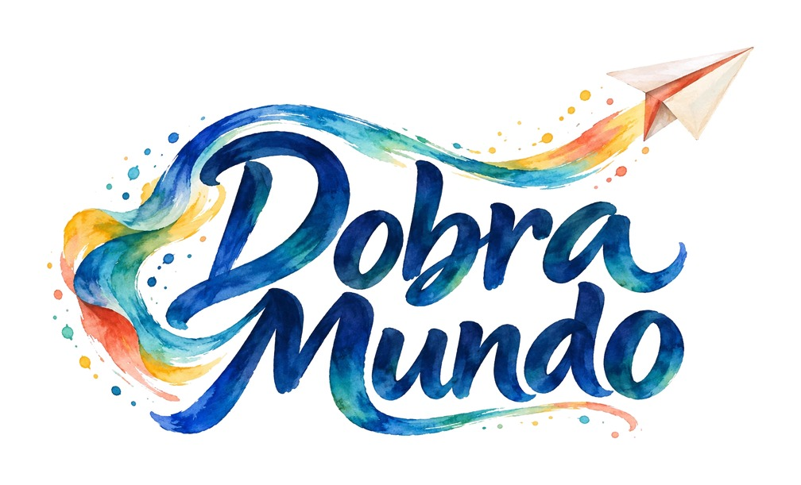
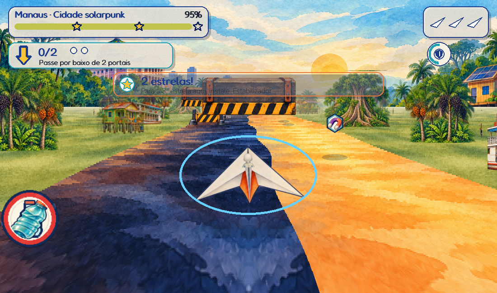
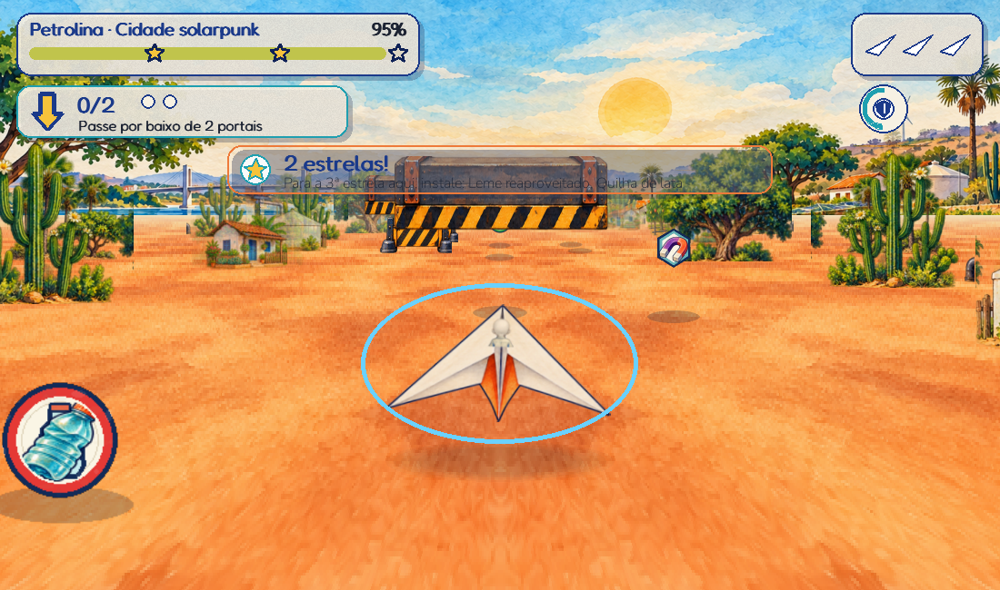

# Dobramundo



**Dobre o papel, voe e transforme o mundo.** Um exergame em papel e aquarela: a criança pilota com o corpo um avião reciclado pela Amazônia e pela Caatinga e constrói uma vila solarpunk.

[](https://github.com/lapsin-maker/dobramundo/actions/workflows/testes.yml)
[](LICENSE)
[](https://github.com/lapsin-maker/dobramundo/releases/latest)


| Amazônia · Manaus | Caatinga · Petrolina |
|---|---|
|  |  |

## Baixar e jogar

1. Abra a [última versão](https://github.com/lapsin-maker/dobramundo/releases/latest) e baixe o pacote **Windows**.
2. Extraia **toda** a pasta; mantenha o executável junto da pasta `_internal`.
3. Abra **Jogar-Dobramundo.bat**. Não é necessário instalar Python. A versão 1.6 mantém o perfil principal legado e oferece slots locais independentes para outros pilotos.

A release também oferece o cartucho `.ttea`, a galeria e hashes SHA-256, quando publicados junto ao pacote. [Entrega 1.6.0 e validação pendente](docs/ENTREGA_1_6.md) · [Histórico](CHANGELOG.md).

## O jogo

Projetado para crianças de 6 a 10 anos, com uso mediado e opções de controle e apresentação ajustáveis. A adequação e o conforto precisam de aceite presencial; este texto não afirma eficácia clínica. A primeira personalização parte de um boneco neutro e inclui pele, cabelos, olhos, roupa, óculos, aparelho auditivo, cadeira de rodas e andador.

O ciclo é **piloto → vila → mapa → voo → resultado → obras e hangar**. A vila começa colorida, industrial e poluída; a coleta e as obras integram natureza, água, energia e alimentos. Manaus e Petrolina mantêm referências de seus biomas e construções nos três estágios.

Durante o voo há resíduos coletáveis, obstáculos, benefícios e metas curtas. As margens e o chão avançam continuamente. As peças do avião preservam a progressão e as exigências da terceira estrela; conforto e calibração estão disponíveis desde o começo.

Detalhes de fases, ODS, regras e referências: [guia do jogo](docs/GUIA_DO_JOGO.md) · [GDD v10](docs/GDD_Dobramundo_v10.pdf).

## Controles e superfícies

- **Corpo:** pés, tronco, mão esquerda, mão direita, duas mãos ou cabeça. No computador, webcam com MediaPipe; no T-TEA, rastreamento do console.
- **Menus:** mirar e permanecer sobre um alvo; o treino ensina mirar, esperar e retirar. Editor de aparência com 3 segundos por padrão, ajustável.
- **Supervisor:** mouse e teclado, setas/WASD, pausa com Esc/P; recalibração e encerramento parcial no menu de pausa.
- **Saída:** chão, mesa, parede ou monitor; rotação e espelho. Pés na projeção exigem calibrar seus quatro cantos.

Em **Opções → Preparar**, escolha exploração sem eliminação, duração (livre ou 120/180/240 s), assistência previsível, contraste, treino e calibração. O editor usa 3 segundos por padrão, ajustável. Calibre o neutro e os quatro alcances confortáveis com confirmação do supervisor. A ampliação no alto contraste vai de 1 a 1,6×.

## Acessibilidade e privacidade

O jogo oferece permanência ajustável, cores e formas distintas, movimento reduzido, volumes independentes, pausa por perda de rastreamento e calibração por segmento. Ajustes de controle não exigem compras na vila.

A câmera é processada localmente; o jogo não grava vídeo nem envia imagens para serviços de IA. O diagnóstico exporta métricas técnicas. As ilustrações de IA são arquivos já incluídos no pacote.

Testes automatizados não substituem o ensaio da pessoa com a câmera, da projeção a 2–3 m e do conforto em sessão mediada. A CI e a validação presencial desta entrega permanecem pendentes; veja [o roteiro presencial](docs/VALIDACAO_PRESENCIAL.md) e as [notas da entrega](docs/ENTREGA_1_6.md).

## Console T-TEA

O cartucho usa a câmera e o rastreamento do console, sem incluir MediaPipe/OpenCV próprios. O SDK oficial instalado exige **Python 3.14** para montar o cartucho; o código portável também é testado em **Python 3.8/3.12** para manter compatibilidade de linguagem.

```powershell
python tools/build_cartridge.py --tsdk CAMINHO_DO_TSDK
```

O check e a construção não equivalem a teste no console físico. [Arquitetura](docs/arquitetura.md).

## Desenvolvimento

```powershell
python -m venv .venv
.venv/Scripts/python -m pip install -r requirements.txt
.venv/Scripts/python -m dobramundo
```

Para webcam, instale as dependências opcionais descritas em [CONTRIBUTING.md](CONTRIBUTING.md). O build Windows utiliza Python 3.12 e `constraints-build.txt`.

```powershell
python -m pytest -q
ruff check .
python -m dobramundo --self-test 1200 --exigir-camera
python tools/benchmark_runtime.py --out build/benchmark --screenshots
python tools/benchmark_camera.py --help
python tools/check_routes.py --help
```

O self-test percorre cenas/fases e carrega o detector de pose; **não abre a webcam**. A medição de câmera é uma ferramenta separada e explícita. `tools/legado` não faz parte do lint ativo. A formatação global ainda é trabalho separado.

Executável: `build_windows.bat` / `build_linux.sh`, ou `python -m PyInstaller --noconfirm Dobramundo.spec`. Os geradores procedurais são fallback e não recriam a arte de IA. [Ferramentas](tools/README.md) · [Arquitetura](docs/arquitetura.md) · [Análise consolidada e prioridades](docs/ANALISE_CONSOLIDADA.md).

## Equipe, créditos e licença

**Liga de Psiquiatria e Neurociências — CENSUPEG**, 3ª ExerGame JAM LARVA/UDESC, 2026. João Pedro Turnes (capitão), Isabella Cordeiro Sonza, Gerciane Larice da Silva Barros e Luiz Felipe Santana Tomio.

Python, Pygame, OpenCV e MediaPipe; captura adaptada do T-TEA 2.0. Programação com apoio de IA generativa; arte aquarelada gerada por IA, com [créditos e procedência](assets/watercolor/CREDITOS.txt). Fontes, modelo de pose e bibliotecas mantêm suas licenças próprias.

Código e conteúdo autoral do jogo: **[CC BY 4.0](LICENSE)**. [Créditos, referências e detalhes das licenças](docs/GUIA_DO_JOGO.md#créditos).
