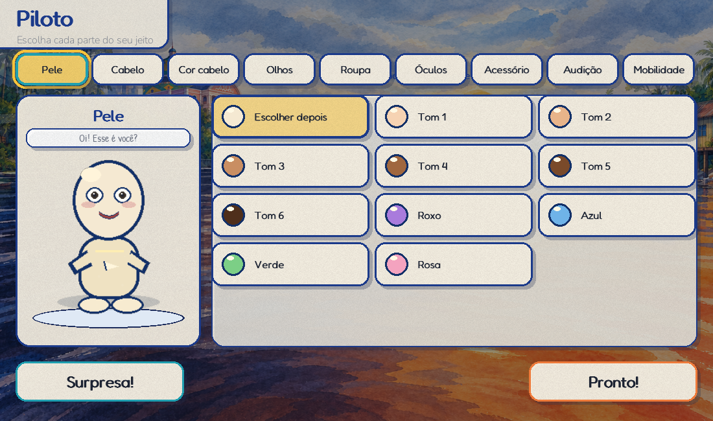
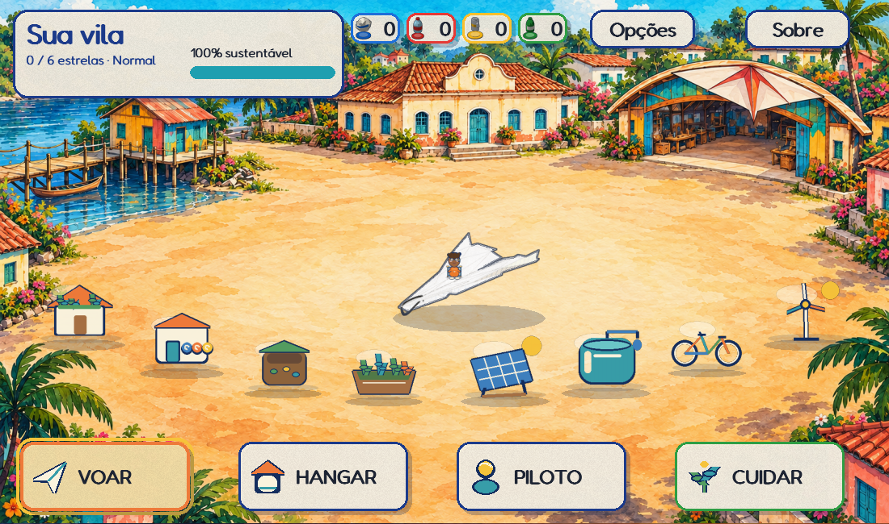
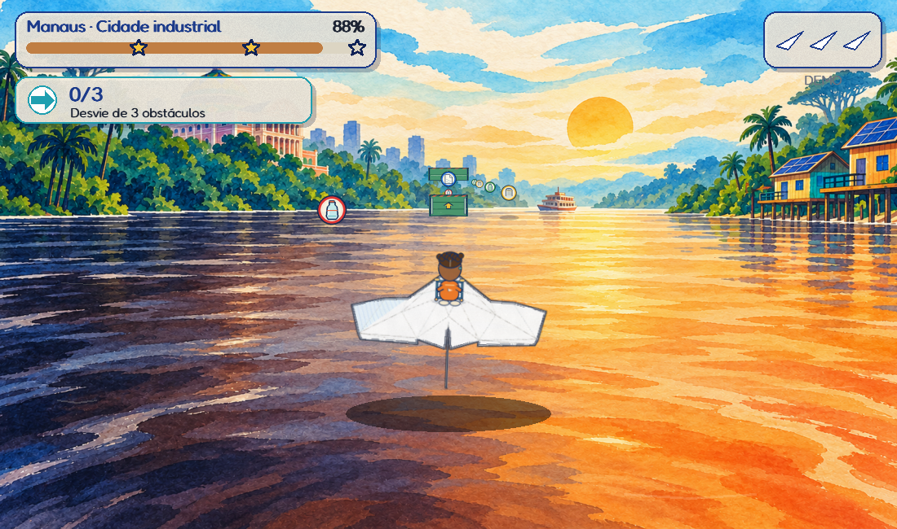
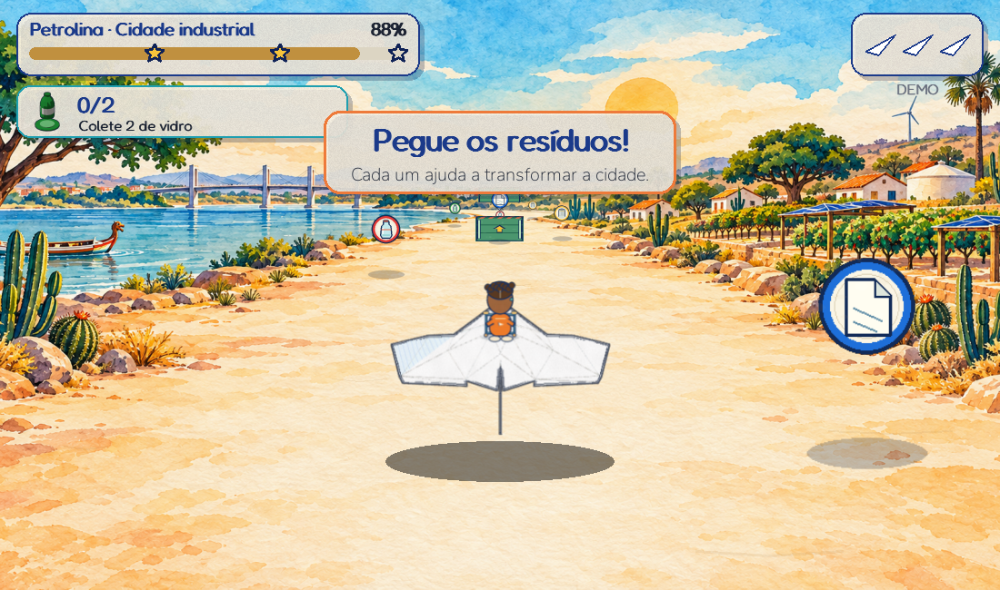

# Dobramundo: papel e aquarela implementados

A direção visual aprovada foi aplicada ao jogo na branch `codex/aquarela-mundo-e-piloto`. As capturas abaixo vêm do renderizador real, com perfis sintéticos e SDL dummy. O pacote continua em Pygame/CPU.

## Experiência entregue

- **Primeiro acesso:** boneco de papel neutro, sem pele, cabelo ou olhos previamente escolhidos. Nove categorias para pele, cabelo, cor do cabelo, olhos, roupa, óculos, acessórios, audição e mobilidade.
- **Representação:** 10 tons de pele, incluindo fantasia; 12 penteados; 6 cores de olhos; óculos; abafador; aparelho auditivo; cadeira de rodas e andador. As escolhas antigas dos perfis são preservadas. Surpresa mantém óculos, abafador e dispositivos assistivos.
- **Fluxo:** piloto → aviso ao supervisor se necessário → calibração corporal se necessária → vila. A história fica em Opções, com avançar, voltar, pular e reprodução automática opcional.
- **Vila:** praça ilustrada, oito obras visíveis, quatro destinos com ícones (Voar, Hangar, Piloto, Cuidar), progresso persistente e transformação do fundo.
- **Melhorias:** quatro cartões por página, prévia, custos por material, confirmação e revelação da obra instalada. As regras da economia e das peças continuam as existentes.
- **Hangar:** 11 dobraduras, cores e padrões preservados, prévia maior e interface de papel.
- **Mapa:** cartões ilustrados das cidades, seleção de ritmo e requisitos de desbloqueio/terceira estrela.
- **Voo:** seis paisagens (duas cidades × três estágios), fichas de coleta com pictogramas distintos, obstáculos desenhados nas medidas da colisão e piloto de costas. HUD reduzido para transformação, estrelas, vidas e missão; recursos/pontos ficam na pausa e no resultado.
- **Acessibilidade:** opção de movimento reduzido suprime paralaxe, marcas do chão, tremor, clarões e respingos; preserva o movimento necessário à jogabilidade. Alto contraste e seleção por permanência continuam funcionando. O alvo diretamente sob o ponteiro tem prioridade sobre a margem de tolerância do cartão vizinho.






## Arte e integração

Oito fundos gerados pela ferramenta integrada de IA estão em `assets/watercolor/`: `amazonia_0/1/2.png`, `caatinga_0/1/2.png`, `village_start.png` e `village_clean.png`. Os prompts finais e os identificadores das saídas estão em [generation.json](../assets/watercolor/generation.json); os créditos, em [CREDITOS.txt](../assets/watercolor/CREDITOS.txt). Os fundos ocupam aproximadamente 22,6 MiB em disco.

As imagens representam lugares brasileiros de forma ilustrativa. Manaus mantém a distinção natural das águas do Negro e Solimões, o Teatro e as palafitas. Petrolina mantém o São Francisco, a ponte, cactos, cisterna e pomares irrigados: a restauração não transforma a Caatinga em floresta úmida.

`engine/watercolor.py` prepara as paisagens uma vez e compõe a transição em passos cacheados, começando pelo horizonte. Marcas discretas do chão acompanham a distância percorrida. Se faltar uma das três imagens de uma cidade, seu cenário procedural anterior continua disponível como fallback completo.

Piloto, fichas, obstáculos e obras são código nativo em `paper_pilot.py`, `paper_items.py` e `village_art.py`. Têm superfícies e escalas cacheadas; não há geração de imagens ou chamadas de rede durante o jogo. Ilustrações decorativas não determinam colisões.

## Verificação em 25/10/2026

- **305 testes passaram** na suíte completa (20,63 s).
- Após ampliar a preservação de óculos/abafador no botão Surpresa, os **10 testes de piloto passaram** novamente.
- Ruff global e `git diff --check` passaram.
- A auditoria AST do cartucho T-TEA passou, incluindo os novos módulos; o stage inclui os oito PNGs e seu manifesto.
- Capturas revisadas: piloto neutro e personalizado, quatro vistas com dispositivos, vila inicial/completa, melhorias/prévia/revelação, mapa, hangar, introdução, seis estados de voo, alto contraste, pausa e resultado.
- Build Windows com PyInstaller 6.22.3 concluído. Conferidos os oito PNGs, manifesto e créditos no bundle.
- Self-test de **1.200 quadros por cidade**, tanto no código-fonte quanto no executável: status `ok`, detector de pose criado e nenhuma falha.

| Ambiente / cidade | Média por quadro | p95 |
|---|---:|---:|
| Fonte / Manaus | 2,70 ms | 4,27 ms |
| Fonte / Petrolina | 2,78 ms | 5,00 ms |
| Executável / Manaus | 2,59 ms | 4,29 ms |
| Executável / Petrolina | 2,88 ms | 4,51 ms |

Essas medições usam SDL dummy neste computador, incluem o passo e a apresentação à superfície simulada e não incluem captura/inferência contínua da webcam. São evidência de margem de CPU para o desenho; não demonstram 60 fps em qualquer projetor/computador. Os menus do self-test têm poucas amostras e não sustentam uma conclusão estatística de p95. Dados resumidos: [validacao-aquarela.json](validacao-aquarela.json).

## Executar e reproduzir

```powershell
.\.venv\Scripts\python.exe -m dobramundo
.\.venv\Scripts\python.exe -m pytest -q --basetemp "<pasta nova de testes>"
.\.venv\Scripts\python.exe -m ruff check dobramundo tests
$env:SDL_VIDEODRIVER='dummy'
$env:SDL_AUDIODRIVER='dummy'
$env:DOBRAMUNDO_DATA_DIR='<pasta de perfil de teste>'
.\.venv\Scripts\python.exe -m dobramundo --self-test 1200 --exigir-camera
```

`--exigir-camera` exige bibliotecas/modelo e a criação do detector; não abre uma webcam física.

O build entregue foi feito diretamente pelo spec, em pastas externas novas, sem reinstalar dependências ou limpar o build anterior:

```powershell
.\.venv\Scripts\python.exe -m PyInstaller --noconfirm --distpath "<saida>" --workpath "<trabalho>" Dobramundo.spec
```

O spec inclui os PNGs e JSONs recursivamente. O cartucho T-TEA usa o mesmo núcleo, excluindo os componentes de janela e câmera que pertencem ao console.

## O que ainda depende de avaliação de campo

Legibilidade física a 2–3 m, enquadramento de câmera, latência com rastreamento ativo e aceitabilidade com crianças neurodiversas ou com deficiência precisam ser observados no equipamento real. Os avatares e as poses são 2D procedurais; os dispositivos ficam pequenos durante o voo e têm maior destaque no editor. As imagens de fundo são pinturas com paralaxe e pistas de movimento, não geometria 3D navegável. Esta entrega não constitui validação clínica, e o cartucho não foi aberto no console T-TEA físico.
