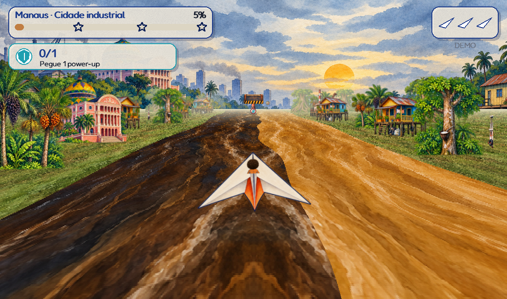
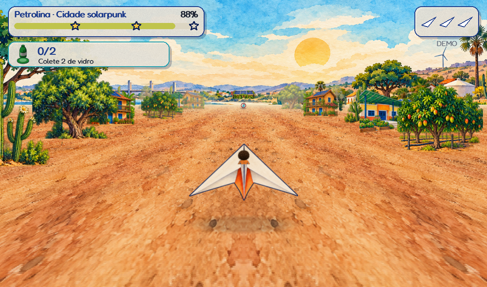
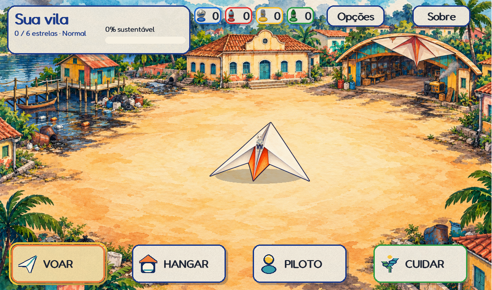
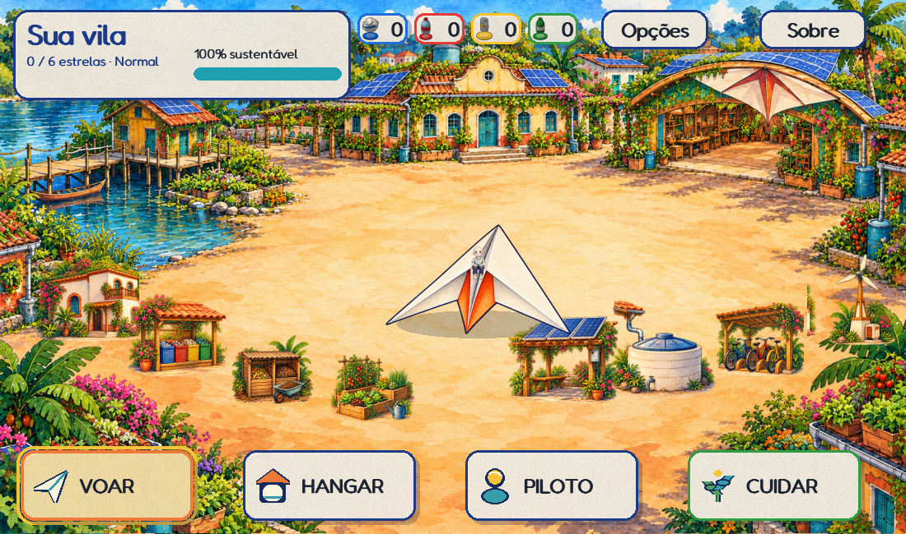
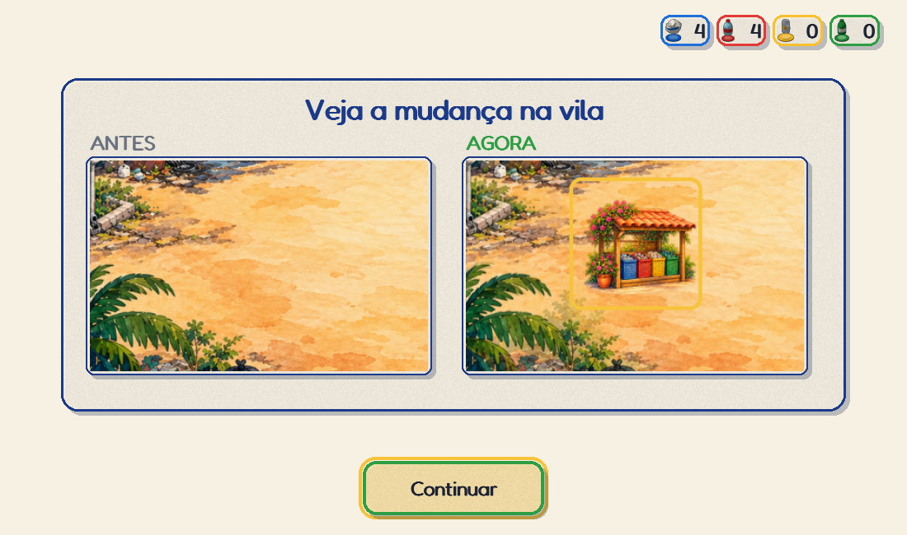

# Dobramundo — sprint 2: aquarela em movimento

O cenário de voo agora avança de verdade. A pintura é o horizonte distante; água e solo são projetados em perspectiva a partir da distância percorrida, e árvores e construções se aproximam e passam pelas laterais. Isso corrige o fundo estático da primeira prévia.

Executável Windows, galeria portátil e instruções de instalação: [entrega da sprint 2](ENTREGA_SPRINT2.md).

## Percurso

- Manaus mantém águas naturais do Negro e Solimões, palafitas, barcos, porto, Teatro Amazonas e vegetação amazônica. A cor escura do Negro não significa poluição.
- Petrolina mantém solo do semiárido, ponte e São Francisco ao horizonte, casas de taipa, cactos, juazeiro, carnaúba, cisterna, fruticultura e energia renovável.
- As margens mudam com os três estágios. As texturas repetem sem reinicializar a distância; os objetos decorativos permanecem ancorados no mundo até saírem do campo de visão.
- Pausar congela o percurso. Movimento reduzido mantém o avanço necessário à navegação, reduz a densidade das margens e suprime paralaxe decorativa, balanço, tremores, clarões e respingos.
- O motor continua Pygame/CPU. Não há GPU, geração de imagens nem chamadas de rede durante a partida.




## Piloto, avião e leitura do voo

O primeiro acesso abre um boneco neutro. Pele, cabelo, olhos, roupa, óculos, acessórios e dispositivos assistivos continuam personalizáveis. O piloto usa base pintada e cabelos em camadas, com frente/costas e poses em pé/sentado; escolhas antigas são preservadas.

Os 11 modelos de avião têm novas dobraduras pintadas, em vistas de voo e hangar. As 15 cores e 26 estampas permanecem disponíveis; cores e padrões se combinam apenas sobre o papel, preservando dobras e contornos. No voo, cabeça e ombros aparecem de costas no cockpit; as pernas ficam ocultas pela dobradura.

Coletas têm moldura circular e material reconhecível. Benefícios têm moldura hexagonal. Barreiras baixas, travessas elevadas e torres usam silhuetas diferentes. Os portais foram recortados para deixar o vão abaixo da travessa visível. As colisões continuam retangulares, conforme os limites de cada ObstacleSpec; não são máscaras por pixel.

Mensagens e missões ficam na região superior com pictogramas de coleta/cima/baixo/lado. O alto contraste escurece o cenário e reforça os objetos.

## Jornada infantil e transformação da vila

Piloto → aviso/calibração quando necessários → vila → mapa → treino opcional no primeiro voo → voo → resultado → vila/obra/hangar. A história é opcional em Opções; o personagem pode ser repersonalizado na vila.

O treino oferece cinco experiências sem perda de vidas ou alteração de recursos: mover, coletar, passar por cima, por baixo e para o lado. A ação bem-sucedida avança a etapa com retorno visual; é possível seguir manualmente, pular, pausar ou voltar. Há mais tempo de aproximação dos obstáculos do que na primeira versão do treino.

A vila começa alegre e colorida, com lixo, água suja e infraestrutura a diesel. O estágio intermediário mistura recuperação e problemas restantes. O final integra jardins, hortas, alimentos em fachadas/telhados, energia solar/eólica, água da chuva e natureza às construções. As oito obras têm props pintados e local definido.

O resultado oferece acesso à próxima obra. A prévia mostra a estrutura no próprio terreno; após a compra, os materiais se deslocam até o local e a obra aparece. No modo de movimento reduzido, um comparativo estático mostra terreno vazio antes e obra instalada depois. A compra é idempotente: confirmar duas vezes não cobra duas vezes.





## Integração e procedência

- `engine/painted_route.py`: perspectiva por faixas de dois pixels, buffers fixos por linha, texturas com repetição espelhada e billboards regionais com cache limitado.
- `engine/watercolor.py`: horizonte por estágio, composição cacheada e fallback para cenário procedural móvel se o pacote novo estiver incompleto.
- `engine/painted_pilot.py` e `engine/painted_planes.py`: atlases, máscaras de cor e composição, incluindo cabelos e dispositivos assistivos pintados em `pilot_hair_front.png`, `pilot_hair_back.png` e `pilot_mobility.png`; `engine/paper_pilot.py` mantém o fallback.
- `paper_items.py` e `village_art.py`: objetos pintados, recortes por alfa e alternativas procedurais.
- `scenes/tutorial.py`: prática isolada da progressão real; `upgrades.py` registra a transformação da obra.
- `Assets` carrega os PNGs pedidos e compartilha a mesma imagem entre consultas, evitando decodificar a pasta inteira a cada sprite.

A arte foi gerada para o projeto. Prompts e saídas estão em [generation.json](../assets/watercolor/generation.json), [generation-sprint2.json](../assets/watercolor/generation-sprint2.json) e [generation-pilot-sprint2.json](../assets/watercolor/generation-pilot-sprint2.json). Os [créditos](../assets/watercolor/CREDITOS.txt) acompanham o pacote e a licença do projeto. A referência visual é interpretada como cenário de jogo em camadas; não se trata de um mundo 3D livre.

## Validação

- **365 testes passaram** na suíte completa local (Python 3.12, 87,94 s), incluindo a auditoria do cartucho T-TEA. Ruff e `git diff --check` passaram.
- O [CI do código da sprint](https://github.com/lapsin-maker/dobramundo/actions/runs/40221637599), commit `b08bcac82a2ffc883f515debcb25afcf8b340861`, passou em Python 3.8 e 3.12: lint, testes e self-test. Consulte os checks do [PR #9](https://github.com/lapsin-maker/dobramundo/pull/9) para a revisão documental posterior.
- Self-tests de **1.200 quadros por cidade** passaram no código-fonte e no executável Windows. As duas cidades chegaram ao terceiro estágio, o detector de pose foi criado e não houve falha registrada.
- Os 28 PNGs e os manifestos/créditos do pacote aquarelado foram comparados por SHA-256 entre o repositório e o bundle: nenhum divergente ou ausente.
- A revisão independente encontrou duas falhas de fallback (atlas de margens vazio e preparo de recursos incompleto), ambas corrigidas e cobertas por regressões.
- A galeria local foi verificada em Chrome: 15 imagens carregadas, nenhuma falha de script, sem rolagem horizontal em 1365 ou 390 px; a animação muda efetivamente os pixels entre quadros.

| Ambiente / cidade | Média por quadro | p95 |
|---|---:|---:|
| Fonte / Manaus | 10,24 ms | 16,18 ms |
| Fonte / Petrolina | 7,18 ms | 10,31 ms |
| Executável / Manaus | 7,46 ms | 9,77 ms |
| Executável / Petrolina | 5,29 ms | 6,96 ms |

Medições incluem atualização/desenho/apresentação em SDL dummy neste computador, após os primeiros dez quadros de cada voo. Não incluem inferência contínua da webcam. O primeiro carregamento de imagens tem custo adicional; estes valores não garantem 60 fps em qualquer equipamento. Dados: [validacao-sprint2.json](validacao-sprint2.json).

As capturas são do Pygame real, com perfil sintético e SDL dummy. A gravação local de cada cidade contém 12 segundos de jogo em 20 quadros/s. O tempo de renderização é medido separadamente. Self-test com `--exigir-camera` carrega o modelo e cria o detector de pose, mas não abre webcam física.

Legibilidade a 2–3 m, rastreamento corporal contínuo, experiência com crianças e desempenho no computador/projetor de uso ainda dependem de avaliação presencial. Não houve validação clínica ou execução no console T-TEA físico nesta sprint.

## Reproduzir

```powershell
.\.venv\Scripts\python.exe -m dobramundo
.\.venv\Scripts\python.exe -m pytest -q --basetemp "<pasta nova de testes>"
.\.venv\Scripts\python.exe -m ruff check dobramundo tests
$env:SDL_VIDEODRIVER='dummy'
$env:SDL_AUDIODRIVER='dummy'
$env:DOBRAMUNDO_DATA_DIR='<perfil de teste>'
.\.venv\Scripts\python.exe -m dobramundo --self-test 1200 --exigir-camera
.\.venv\Scripts\python.exe -m PyInstaller --noconfirm --distpath "<saida nova>" --workpath "<trabalho novo>" Dobramundo.spec
```
